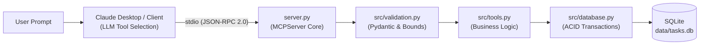

# PROJECT INTERVIEW QUICK REVISION SHEET

**Project:** Natural Language SQLite MCP Server for AI Agent Tool Integration  
**Repository:** `mcp-sqlite-server` | [GitHub Link](https://github.com/DineethKonakalla703/mcp-sqlite-server)  
**Developer:** Dineeth Konakalla (`DineethKonakalla703`)  
**Purpose:** Rapid 5-minute pre-interview refresher and memorization cheat sheet.

---

## 1. The High-Impact Pitches (Memorize These)

### 30-Second Elevator Pitch
> *"I designed and built a production-grade Model Context Protocol (MCP) server in Python that connects LLMs like Claude directly to relational SQLite databases. Rather than exposing dangerous arbitrary SQL, my server exposes eight strictly validated, transactional tools for task and project management. It provides 100% parameterization, automatic transaction rollbacks, clean stdio transport, and is verified with 50 automated tests."*

### 90-Second Technical Overview
> *"The major flaw in modern agentic AI is giving LLMs arbitrary SQL execution permissions, which introduces prompt injection and data loss risks. I solved this by implementing an MCP server that acts as an authoritative validation and transaction boundary.*
> 
> *The server is built with Python 3.12, the official MCP SDK, and SQLite. When an AI client like Claude Desktop receives a conversational request—like 'What high priority tasks are overdue?'—it invokes our server via standard input/output over JSON-RPC 2.0. Our server validates the input with Pydantic, checks business rules, and executes parameterized SQL.*
> 
> *Key architectural highlights include strict redirection of all logging to stderr to prevent stdout JSON-RPC frame corruption, atomic multi-table transaction rollbacks, and idempotent database seeding. The test suite includes 50 automated tests in Pytest covering everything from SQL injection attempts to protocol-level tool discovery."*

---

## 2. Architecture at a Glance

* **Transport:** Bidirectional standard I/O streams (`stdin` / `stdout`).
* **Protocol:** Model Context Protocol (MCP) using JSON-RPC 2.0.
* **Stream Isolation:** `stdout` = JSON-RPC only. `stderr` = Diagnostic logs & errors.

---

## 3. Technology Stack Cheat Sheet

| Component | Technology | Version | Key Reason for Choice |
| :--- | :--- | :--- | :--- |
| **Language** | Python | 3.12 | Modern type hinting, native context managers, robust asyncio. |
| **Protocol SDK** | Official MCP SDK | 2.2 (`mcp`) | Standardized tool schema generation and transport management. |
| **Database** | SQLite 3 | Embedded | Serverless, zero-config, ACID-compliant, native relational support. |
| **Validation** | Pydantic | 2.13 | High-speed C-based validation (`pydantic-core`) and boundary limits. |
| **Testing** | Pytest + Asyncio | 9.1 / 1.4 | Comprehensive asynchronous test execution with isolated temp DBs. |
| **Config** | python-dotenv | 1.2 | Twelve-Factor App path and environment decoupling. |

---

## 4. Key Files and Their Single Responsibility

* **`server.py`:** Initializes `MCPServer`, declares the 8 tool interfaces with docstrings for the LLM, and runs the stdio event loop.
* **`config.py`:** Resolves project paths, defines validation constants (`MAX_TITLE_LENGTH = 200`), and binds logging to `sys.stderr`.
* **`src/models.py`:** Immutable Pydantic models (`Task`, `Project`, `TaskSummary`, input schemas).
* **`src/validation.py`:** Standalone validator functions (`validate_status`, `validate_id`, `validate_due_date`).
* **`src/tools.py`:** Pure business logic functions executing tool behavior, decoupled from transport.
* **`src/database.py`:** SQLite connection context manager, table DDL, queries, and atomic transactions.
* **`scripts/init_db.py`:** Creates SQLite tables and indexes safely (`CREATE TABLE IF NOT EXISTS`).
* **`scripts/seed_db.py`:** Idempotently inserts sample projects and tasks without duplicates.

---

## 5. The 8 Standardized MCP Tools

| Tool Name | Parameters | Core Responsibility |
| :--- | :--- | :--- |
| `list_tasks` | `status` (opt), `priority` (opt), `limit` (opt) | Query tasks with multi-field filtering and bounds. |
| `get_task` | `task_id` (req) | Retrieve a single task by ID with joined project name. |
| `search_tasks` | `query` (req), `limit` (opt) | Safe keyword search in titles and descriptions using escaped LIKE. |
| `list_projects` | *None* | List all projects with dynamic task count aggregation. |
| `get_project_tasks` | `project_id` (req) | Retrieve all tasks assigned to a specific project ID. |
| `create_task` | `title` (req), `desc`, `priority`, `due_date`, `project_id` | Atomic creation of a task and project assignment. |
| `update_task_status` | `task_id` (req), `status` (req) | State transition (`pending` $\rightarrow$ `in_progress` $\rightarrow$ `completed`). |
| `get_task_summary` | *None* | Real-time aggregate metrics (total, by status, by priority, overdue). |

---

## 6. Database Schema & Entities

* **`projects` (`id` PK, `name` UNIQUE, `description`, `created_at`)**
* **`tasks` (`id` PK, `title`, `description`, `status` CHECK, `priority` CHECK, `due_date`, `created_at`)**
* **`task_projects` (`task_id` FK, `project_id` FK, PRIMARY KEY (`task_id`, `project_id`), `ON DELETE CASCADE`)**
* **Indexes:** `idx_tasks_status`, `idx_tasks_priority`, `idx_tasks_due_date`, `idx_task_projects_project`.
* **Foreign Keys:** Explicitly activated via `PRAGMA foreign_keys = ON;` on every connection.

---

## 7. Top 5 Technical Decisions (Why You Built It This Way)

1. **Domain Tools over Arbitrary SQL:** Prevents prompt injection, schema corruption, and destructive writes at the architecture layer.
2. **Stdout / Stderr Stream Hygiene:** Prevents JSON-RPC framing corruption by strictly directing all logging and diagnostic output to `sys.stderr`.
3. **Atomic Multi-Table Transactions:** Guarantees that creating a task with an invalid `project_id` cleanly rolls back without creating orphan records.
4. **Parameterized LIKE Wildcard Escaping:** Replaces raw wildcards (`%`, `_`, `\`) with escaped representations to eliminate wildcard denial-of-service and injection.
5. **Idempotent Data Seeding:** Allows initialization and seeding scripts to be run repeatedly without generating duplicate records.

---

## 8. Top 10 Most Likely Interview Questions (Quick Answers)

1. **Q: What is the Model Context Protocol (MCP)?**  
   *A:* An open standard created by Anthropic that provides a unified JSON-RPC protocol for LLMs to access tools, data resources, and prompt templates over `stdio` or HTTP.
2. **Q: How do you prevent SQL injection in search?**  
   *A:* We use parameterized query placeholders (`?`) and run input through `escape_like_pattern` to escape `%`, `_`, and `\`.
3. **Q: What happens if an unhandled exception occurs inside a tool?**  
   *A:* The exception is logged to `stderr`, and the server returns a masked error payload (`{"success": false, "error": "..."}`) so the client session never crashes.
4. **Q: Why is logging to stdout dangerous in MCP?**  
   *A:* The MCP stdio transport requires pure JSON-RPC messages on `stdout`. Any raw log output breaks the JSON-RPC parser in Claude Desktop.
5. **Q: How does `create_task` maintain data integrity?**  
   *A:* It runs inside an atomic transaction context manager (`with conn:`). It verifies the `project_id` exists before inserting; if it does not, it rolls back.
6. **Q: How many tests exist and how are they isolated?**  
   *A:* 50 automated tests in Pytest passing in under 4 seconds. Tests use a `tmp_path` fixture so the real database (`tasks.db`) is never touched.
7. **Q: What date format is used?**  
   *A:* ISO 8601 (`YYYY-MM-DD`). It guarantees accurate chronological sorting in SQLite string comparisons.
8. **Q: Does SQLite support foreign keys by default?**  
   *A:* No. SQLite disables foreign keys by default. We explicitly execute `PRAGMA foreign_keys = ON;` on every connection.
9. **Q: How does the server handle concurrent writes?**  
   *A:* SQLite uses file-level locking. We set `timeout=10.0` on connection setup so simultaneous operations queue rather than immediately error out.
10. **Q: How do you support both MCP SDK v1 and v2?**  
    *A:* Using a fallback import pattern (`try from mcp.server.mcpserver import MCPServer except ImportError from mcp.server.fastmcp import FastMCP as MCPServer`).

---

## 9. Key Terminology to Know Cold

* **MCP (Model Context Protocol):** Open protocol standardizing AI-to-tool communication.
* **JSON-RPC 2.0:** Stateless, lightweight remote procedure call protocol encoding requests and responses in JSON.
* **Stdio Transport:** Inter-process communication using standard input and output pipes.
* **ACID Transactions:** Atomicity, Consistency, Isolation, Durability guarantees in relational databases.
* **Idempotency:** An operation that produces the exact same result whether executed once or multiple times.
* **Parameterized SQL:** Pre-compiled database query using variable placeholders to prevent code injection.
* **Foreign Key Cascade:** A database constraint that automatically deletes child junction rows when parent records are deleted.
