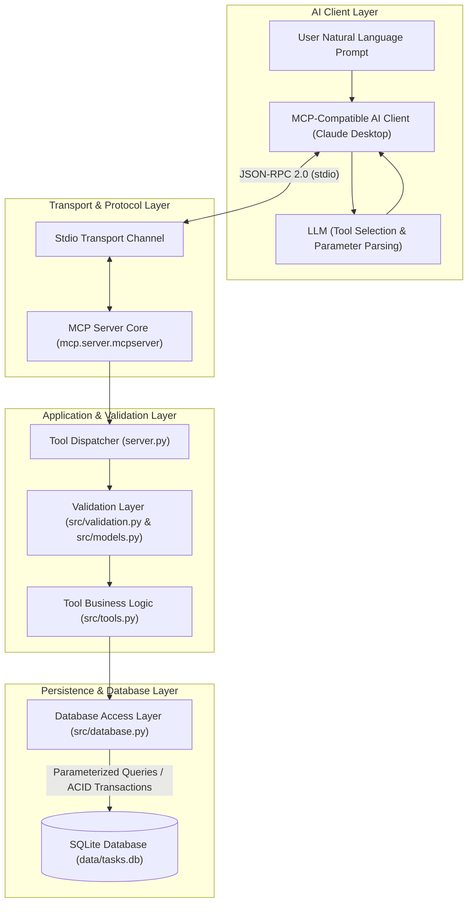

# Natural Language SQLite MCP Server for AI Agent Tool Integration

A production-grade, secure [Model Context Protocol (MCP)](https://modelcontextprotocol.io/) server written in Python. It exposes a local SQLite task-management database through standardized MCP tools, enabling LLM-powered AI clients (such as Claude Desktop, Cursor, or autonomous agents) to query and manage relational data through natural-language conversation.

---

## 1. Problem Statement

When connecting Large Language Models (LLMs) to relational databases, developers frequently resort to exposing arbitrary text-to-SQL execution endpoints. While flexible, this pattern introduces severe security vulnerabilities:
* Vulnerability to prompt injection and malicious SQL commands (e.g., `DROP TABLE`, destructive writes).
* Risk of schema exfiltration and accidental data corruption.
* Lack of deterministic input validation and application domain guardrails.

The Model Context Protocol solves this by standardizing how AI clients discover and execute tools. Rather than giving an AI direct database credentials or arbitrary execution power, this server provides a strictly validated domain tool layer that enforces business rules and parameterized transactions.

---

## 2. Project Objectives

* **Provide Safe Database Access:** Deliver an auditable, parameterized interface for SQLite databases without exposing raw SQL execution.
* **Support Standard MCP Protocol:** Implement full protocol compliance using the official Python MCP SDK with stdio transport.
* **Facilitate Natural Language Interaction:** Allow AI models to translate conversational intents into validated function calls.
* **Ensure Robust Security & Quality:** Implement Pydantic validation, ACID transactions, stderr logging isolation, and 100% automated test coverage.

---

## 3. Difference Between MCP Server and AI Client

It is important to understand the division of responsibilities:

* **The AI Client (e.g., Claude Desktop, Cursor):**
  Houses the LLM. It interprets the user's natural language request (e.g., *"Find all urgent tasks"*), matches the request to available MCP tool schemas, formulates valid arguments, and formats the tool results back into conversational answers.
* **The MCP Server (This Project):**
  Provides tool declarations, validates input parameters, executes business logic, queries SQLite using parameterized SQL, and returns structured data over JSON-RPC. **The server does not perform natural-language understanding on its own; it provides the deterministic execution capabilities.**

---

## 4. Key Features

* **8 Specialized MCP Tools:** Complete task and project lifecycle management (search, filter, create, update, aggregate).
* **ACID Transaction Safety:** All database modifications run in isolated transactions with automatic rollback on error.
* **SQL Injection Neutralization:** Parameterized SQL queries for all variables and escaped wildcards in search patterns.
* **Strict Validation Layer:** Input length bounds, enum constraints (`status`, `priority`), and ISO 8601 date parsing.
* **Clean Stdio Transport:** Standard output (`stdout`) is reserved strictly for JSON-RPC; all logs and diagnostics route to `stderr`.
* **Idempotent Seeding:** Initialize and seed sample data without duplicating existing records.
* **Comprehensive Test Suite:** 50 automated pytest tests covering database operations, security bounds, and protocol-level execution.

---

## 5. Technology Stack

* **Language:** Python 3.11+ (Verified on Python 3.12.1)
* **MCP Protocol SDK:** `mcp` (Official Model Context Protocol Python SDK)
* **Database Engine:** SQLite 3 (via standard library `sqlite3` with foreign key enforcement)
* **Data Validation:** Pydantic 2.x
* **Testing:** Pytest 9.x and Pytest-Asyncio
* **Configuration:** `python-dotenv`
* **Transport:** JSON-RPC 2.0 over Standard Input/Output (`stdio`)

---

## 6. Architecture Diagram



---

## 7. Project Structure

```text
mcp-sqlite-server/
├── .env.example              # Sample environment variable template
├── .gitignore                # Git ignore rules for venv, sqlite data, logs
├── config.py                 # Configuration, path resolution, and stderr logging
├── pyproject.toml            # Project metadata and test configuration
├── requirements.txt          # Pinned project dependencies
├── server.py                 # MCP server entrypoint and tool registration
├── data/
│   ├── .gitkeep              # Git tracking placeholder (runtime .db files ignored)
│   └── tasks.db              # Local SQLite database (created at runtime)
├── docs/
│   ├── architecture.md       # In-depth architectural design and sequence flows
│   └── mcp_client_setup.md   # Step-by-step AI client setup instructions
├── scripts/
│   ├── init_db.py            # Safe database schema initialization
│   └── seed_db.py            # Idempotent fictional sample dataset seeding
├── src/
│   ├── __init__.py           # Package marker
│   ├── database.py           # SQLite connection, queries, and transactions
│   ├── models.py             # Pydantic data schemas
│   ├── tools.py              # Implementation of the 8 MCP tools
│   └── validation.py         # Reusable input validation and security checks
└── tests/
    ├── test_database.py      # Database layer tests (CRUD, foreign keys, SQLi)
    ├── test_tools.py         # Direct tool tests and MCP protocol tests
    └── test_validation.py    # Input validation tests (bounds, formats, types)
```

---

## 8. Prerequisites

* **Python:** Version 3.11 or newer (Python 3.12 recommended).
* **Git:** Version 2.40+.
* **OS:** Windows, macOS, or Linux.
* **Optional Client:** Claude Desktop, Cursor, or Node.js (for `@modelcontextprotocol/inspector`).

---

## 9. Installation & Setup

### 9.1 Clone or Navigate to the Repository

```bash
git clone https://github.com/<your-username>/mcp-sqlite-server.git
cd mcp-sqlite-server
```

### 9.2 Create and Activate a Virtual Environment

**Windows:**
```powershell
py -3.12 -m venv .venv
.venv\Scripts\Activate.ps1
```

**macOS / Linux:**
```bash
python3 -m venv .venv
source .venv/bin/activate
```

### 9.3 Install Dependencies

```bash
pip install -r requirements.txt
```

---

## 10. Database Initialization & Seeding

### 10.1 Initialize Schema
Creates the `projects`, `tasks`, and `task_projects` tables, indexes, and enables foreign key constraints without modifying existing records:

```bash
python scripts/init_db.py
```

### 10.2 Seed Sample Data
Populates the database with realistic fictional tasks and projects. This script is **idempotent** and will not duplicate records if executed repeatedly:

```bash
python scripts/seed_db.py
```

---

## 11. Running the Server

Start the MCP server over standard I/O:

```bash
python server.py
```

*Note: The server listens for JSON-RPC messages via standard input (`stdin`) and writes responses to standard output (`stdout`). Diagnostic logs are sent to `stderr`.*

To test with the interactive MCP Inspector:
```bash
npx @modelcontextprotocol/inspector python server.py
```

---

## 12. MCP Tool Reference

The server exposes 8 standardized tools:

| Tool Name | Parameters | Description |
| :--- | :--- | :--- |
| `list_tasks` | `status` *(str, opt)*<br>`priority` *(str, opt)*<br>`limit` *(int, opt, default: 20)* | Lists tasks with optional filtering by status (`pending`, `in_progress`, `completed`) and priority (`low`, `medium`, `high`, `urgent`). |
| `get_task` | `task_id` *(int, req)* | Retrieves full details for a single task including its assigned project. |
| `search_tasks` | `query` *(str, req)*<br>`limit` *(int, opt, default: 10)* | Case-insensitive keyword search in task titles and descriptions. Parameterized and safe from injection. |
| `list_projects` | *None* | Lists all projects along with description, creation timestamp, and count of associated tasks. |
| `get_project_tasks` | `project_id` *(int, req)* | Retrieves all tasks assigned to a specific project ID. |
| `create_task` | `title` *(str, req)*<br>`description` *(str, opt)*<br>`priority` *(str, opt, default: "medium")*<br>`due_date` *(str, opt)*<br>`project_id` *(int, opt)* | Creates a new task within a database transaction. Validates title length, priority enum, date format, and project foreign key. |
| `update_task_status` | `task_id` *(int, req)*<br>`status` *(str, req)* | Updates the status of an existing task to `pending`, `in_progress`, or `completed`. |
| `get_task_summary` | *None* | Computes aggregate statistics: total tasks, counts grouped by status, counts grouped by priority, and overdue task count. |

---

## 13. Example Natural-Language Prompts

When connected to an AI client (such as Claude Desktop), users can ask natural language questions:

* *"Show me all tasks that are currently high priority."*  
  $\rightarrow$ Invokes `list_tasks(priority="high")`
* *"Search for tasks mentioning Kubernetes."*  
  $\rightarrow$ Invokes `search_tasks(query="Kubernetes")`
* *"What projects do we have and how many tasks are in each?"*  
  $\rightarrow$ Invokes `list_projects()`
* *"Mark task #2 as completed."*  
  $\rightarrow$ Invokes `update_task_status(task_id=2, status="completed")`
* *"Give me a summary of our workload and how many tasks are overdue."*  
  $\rightarrow$ Invokes `get_task_summary()`
* *"Create an urgent task titled 'Patch OpenSSL vulnerability' due on 2026-11-01 for project 1."*  
  $\rightarrow$ Invokes `create_task(title="Patch OpenSSL vulnerability", priority="urgent", due_date="2026-11-01", project_id=1)`

---

## 14. Security Measures

1. **No Arbitrary SQL Execution:** The server does not expose an open SQL query tool. All database interactions are confined to pre-compiled, parameter-bound application logic.
2. **Parameterized SQL Queries:** All variable inputs are supplied to SQLite via parameter placeholders (`?`). String concatenation is never used to construct SQL statements.
3. **LIKE Pattern Escaping:** Search queries escape `%`, `_`, and `\` characters to prevent wildcard manipulation.
4. **Input Boundary Enforcement:** Titles are restricted to 200 characters, descriptions to 2,000 characters, queries to 100 characters, and result limits to 100 records.
5. **Sanitized Error Messaging:** Database-level exceptions and stack traces are logged to `stderr` but masked from the client response to prevent information disclosure.
6. **Data Isolation in Git:** Runtime SQLite database files (`data/*.db`) and `.env` files are excluded in `.gitignore` to prevent committing local data or secrets.
7. **No Secrets in Source:** All configuration relies on optional environment variables with safe defaults.

---

## 15. Testing & Verification

The project includes an automated test suite using `pytest` and `pytest-asyncio`. Tests use an isolated temporary database fixture (`tmp_path`) to ensure the production database is never modified during tests.

### Running Tests

```bash
pytest -v
```

### Actual Test Results

```text
============================= test session starts =============================
platform win32 -- Python 3.12.1, pytest-9.1.1, pluggy-1.6.0
rootdir: D:\dineth lakshmi\Documents\projects_\mcp_server_project
configfile: pyproject.toml
testpaths: tests
plugins: anyio-4.15.1, asyncio-1.4.0
collected 50 items

tests/test_database.py::TestDatabase::test_schema_initialization PASSED          [  2%]
tests/test_database.py::TestDatabase::test_seeding_and_duplicate_prevention PASSED [  4%]
tests/test_database.py::TestDatabase::test_list_tasks_and_filtering PASSED         [  6%]
tests/test_database.py::TestDatabase::test_get_task_success_and_not_found PASSED   [  8%]
tests/test_database.py::TestDatabase::test_search_tasks PASSED                   [ 10%]
tests/test_database.py::TestDatabase::test_sql_injection_protection PASSED         [ 12%]
tests/test_database.py::TestDatabase::test_list_projects PASSED                  [ 14%]
tests/test_database.py::TestDatabase::test_get_project_tasks PASSED              [ 16%]
tests/test_database.py::TestDatabase::test_create_task_with_and_without_project PASSED [ 18%]
tests/test_database.py::TestDatabase::test_create_task_invalid_project_rolls_back PASSED [ 20%]
tests/test_database.py::TestDatabase::test_update_task_status PASSED             [ 22%]
tests/test_database.py::TestDatabase::test_get_task_summary PASSED               [ 24%]
tests/test_tools.py::TestDirectTools::test_list_tasks_tool_filtering PASSED       [ 26%]
tests/test_tools.py::TestDirectTools::test_list_tasks_tool_invalid_status PASSED  [ 28%]
tests/test_tools.py::TestDirectTools::test_get_task_tool_valid PASSED            [ 30%]
tests/test_tools.py::TestDirectTools::test_get_task_tool_invalid_id PASSED       [ 32%]
tests/test_tools.py::TestDirectTools::test_search_tasks_tool PASSED              [ 34%]
tests/test_tools.py::TestDirectTools::test_search_tasks_tool_empty_query PASSED  [ 36%]
tests/test_tools.py::TestDirectTools::test_list_projects_tool PASSED             [ 38%]
tests/test_tools.py::TestDirectTools::test_get_project_tasks_tool PASSED         [ 40%]
tests/test_tools.py::TestDirectTools::test_create_task_tool PASSED               [ 42%]
tests/test_tools.py::TestDirectTools::test_create_task_tool_invalid_priority PASSED [ 44%]
tests/test_tools.py::TestDirectTools::test_update_task_status_tool PASSED        [ 46%]
tests/test_tools.py::TestDirectTools::test_get_task_summary_tool PASSED          [ 48%]
tests/test_tools.py::TestMCPProtocolIntegration::test_tool_discovery PASSED     [ 50%]
tests/test_tools.py::TestMCPProtocolIntegration::test_protocol_call_list_tasks PASSED [ 52%]
tests/test_tools.py::TestMCPProtocolIntegration::test_protocol_call_get_task PASSED [ 54%]
tests/test_tools.py::TestMCPProtocolIntegration::test_protocol_call_get_task_not_found PASSED [ 56%]
tests/test_tools.py::TestMCPProtocolIntegration::test_protocol_call_search_tasks PASSED [ 58%]
tests/test_tools.py::TestMCPProtocolIntegration::test_protocol_call_create_task PASSED [ 60%]
tests/test_tools.py::TestMCPProtocolIntegration::test_protocol_call_create_task_invalid_input PASSED [ 62%]
tests/test_tools.py::TestMCPProtocolIntegration::test_protocol_call_update_task_status PASSED [ 64%]
tests/test_tools.py::TestMCPProtocolIntegration::test_protocol_call_summary PASSED [ 66%]
tests/test_validation.py::TestValidation::test_validate_id_valid PASSED          [ 68%]
tests/test_validation.py::TestValidation::test_validate_id_invalid PASSED        [ 70%]
tests/test_validation.py::TestValidation::test_validate_status_valid PASSED      [ 72%]
tests/test_validation.py::TestValidation::test_validate_status_invalid PASSED    [ 74%]
tests/test_validation.py::TestValidation::test_validate_priority_valid PASSED    [ 76%]
tests/test_validation.py::TestValidation::test_validate_priority_invalid PASSED  [ 78%]
tests/test_validation.py::TestValidation::test_validate_title_valid PASSED       [ 80%]
tests/test_validation.py::TestValidation::test_validate_title_empty_or_whitespace PASSED [ 82%]
tests/test_validation.py::TestValidation::test_validate_title_max_length PASSED [ 84%]
tests/test_validation.py::TestValidation::test_validate_description_valid PASSED [ 86%]
tests/test_validation.py::TestValidation::test_validate_description_max_length PASSED [ 88%]
tests/test_validation.py::TestValidation::test_validate_query_valid PASSED       [ 90%]
tests/test_validation.py::TestValidation::test_validate_query_invalid PASSED     [ 92%]
tests/test_validation.py::TestValidation::test_validate_due_date_valid PASSED    [ 94%]
tests/test_validation.py::TestValidation::test_validate_due_date_invalid PASSED  [ 96%]
tests/test_validation.py::TestValidation::test_validate_limit_valid PASSED       [ 98%]
tests/test_validation.py::TestValidation::test_validate_limit_invalid PASSED     [100%]

============================= 50 passed in 4.90s ==============================
```

---

## 16. Troubleshooting

* **Tool responses fail or timeout in Claude Desktop:**
  Verify that no `print()` statements are executed during server runtime. MCP stdio relies on an uninterrupted JSON-RPC channel on `stdout`.
* **Database path resolution:**
  By default, `data/tasks.db` relative to the project root is used. To use a different database location, set `DB_PATH=/absolute/path/to/tasks.db` in your environment or `.env` file.
* **Module import errors:**
  Always run the server using the virtual environment's Python interpreter (`.venv/Scripts/python.exe` or `.venv/bin/python`).

---

## 17. Known Limitations

* **Single-Node SQLite:** Designed for single-machine local agent integration. Highly concurrent distributed writes require an enterprise database backend like PostgreSQL.
* **Full-Text Search:** Currently relies on parameterized `LIKE` operators. For datasets exceeding 100,000 tasks, SQLite FTS5 (Full-Text Search 5) would offer higher throughput.

---

## 18. Future Enhancements

* **SQLite FTS5 Integration:** Add BM25-ranked full-text indexing for faster natural language task searches.
* **REST & Webhook Bridge:** Expose tools to trigger external notifications (e.g., Slack, GitHub Issues) when tasks are marked urgent.
* **Task Pagination & Sorting:** Add cursor-based pagination for larger enterprise databases.
* **Observability & OpenTelemetry:** Implement structured tracing for tool execution latencies and token utilization.
