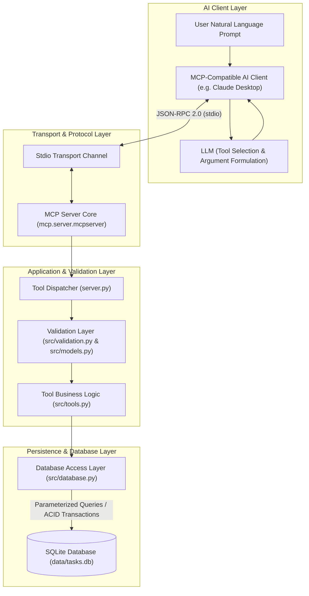
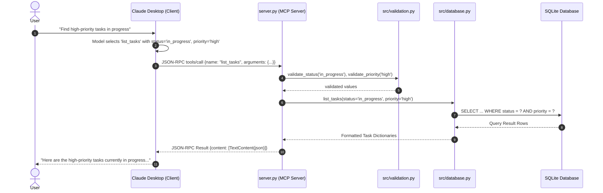

# Architecture and System Design

## 1. System Overview

The **Natural Language SQLite MCP Server** is a modular Model Context Protocol (MCP) server engineered to provide AI clients (such as Claude Desktop or autonomous agents) with safe, structured, and auditable access to a relational SQLite database.

Rather than exposing raw SQL execution to the AI model, the server implements strict domain-specific MCP tools. This ensures that the AI model acts as a natural language semantic planner while the MCP server enforces application invariants, input constraints, and database security.

---

## 2. High-Level Architecture Diagram

---

## 3. Tool Invocation Sequence

---

## 4. Key Architectural Decisions

### 4.1 Strict Domain Tools vs. Arbitrary SQL
* **Decision:** We explicitly avoided exposing an arbitrary `execute_sql` tool.
* **Rationale:** Exposing arbitrary SQL execution creates an insurmountable prompt-injection vector, allowing an attacker or hallucinatory prompt to drop tables, exfiltrate metadata, or tamper with system integrity. Providing explicit domain tools (`list_tasks`, `create_task`, etc.) enforces the principle of least privilege.

### 4.2 Parameterized SQL and Pattern Escaping
* **Decision:** Every database query uses parameter placeholders (`?`). LIKE queries escape literal special characters (`%`, `_`, `\`).
* **Rationale:** Completely neutralizes SQL injection attacks while retaining predictable search semantics.

### 4.3 Stdio Protocol Cleanliness
* **Decision:** All diagnostics and errors are routed exclusively to `sys.stderr`.
* **Rationale:** The MCP stdio transport relies on valid JSON-RPC frames arriving over `sys.stdout`. Emitting `print()` statements or unformatted logs to `stdout` corrupts the transport framing and crashes client connections.

### 4.4 Idempotent Database Operations
* **Decision:** Table creation uses `CREATE TABLE IF NOT EXISTS`, and the database seed utility checks for record uniqueness prior to insertion.
* **Rationale:** Allows environments to run initialization scripts on startup without data duplication or disruption of existing workflows.
